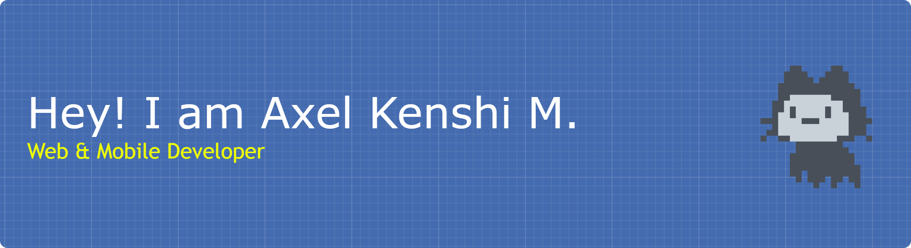

  

<!-- Simple biograpy -->
<h1 align="left">Hey, What's up? 🙋‍♂️</h1>

I’m Axel — a student developer from Bandung, Indonesia (🇮🇩) with a deep interest in how software can solve real-world problems. Currently, I'm sharpening my foundation in Software Engineering at a vocational high school, where I've fallen in love with the process of building clean and purposeful digital products. 

Beyond the classroom, I immerse myself in Mobile development and AI-driven automation. I don't just want to write code; I strive to write it elegantly and maintainably. Driven by curiosity, I'm constantly experimenting with the synergy between technical logic and creative branding—always building with a 'purpose-first' mindset.

<h2 align="left">🌱 A little bit About me</h2>

  🎭 <b>Pronoun:</b> Axel ヾ(＠⌒ー⌒＠)ノ 
  🌐 <b>Portfolio:</b> <a href="https://axelkenshi.my.id">See Me!</a> 
  📚 <b>Currently Learning:</b> Flutter 
  🎯 <b>Goals:</b> Building impactful open-source projects 
  🎲 <b>Fun fact:</b> Really like exploring the latest AI trends 
  💡 <b>Philosophy:</b> Code with clarity, brand with boldness, building with purpose. 
  🧠 <b>Thinking Style:</b> Detail-oriented & creatively curious

  

<!-- Productivity Stats -->
<h1 align="left">📊 Activity Stats</h1>

<!-- github stats & language for readme -->
<table width="100%">
  <tr>
    <!-- left column: github streak -->
    <td width="50%" align="center" style="border: none;">
      
    </td>
    <!-- right column: language stats -->
    <td width="50%" align="center" style="border: none;">
      
    </td>
  </tr>
</table>

<!-- packman -->
<picture>
  <source media="(prefers-color-scheme: dark)" srcset="https://raw.githubusercontent.com/axelkenshi/axelkenshi/output/pacman-contribution-graph-dark.svg">
  <source media="(prefers-color-scheme: light)" srcset="https://raw.githubusercontent.com/axelkenshi/axelkenshi/output/pacman-contribution-graph.svg">
  
</picture>

<!-- Highlight Project's -->
<!-- <h1 align="center">🚀 Featured Projects</h1> -->

<table width="100%">
  <tr>
    <!-- left column: AniList -->
    <td width="50%" align="center" style="border: none;">
      
    </td>
    <!-- right column: Metrics -->
    <td width="50%" align="center" style="border: none;">
      
    </td>
  </tr>
</table>

  

