<!-- Whoami Profile banner custom svg -->

  

  

<!-- Productivity Stats -->
<h1 align="left">📊 Activity Stats</h1>

<!-- github stats & language for readme -->
<table width="100%">
  <tr>
    <!-- left column: github streak -->
    <td width="50%" align="center" style="border: none;">
      
    </td>
    <!-- right column: language stats -->
    <td width="50%" align="center" style="border: none;">
      
    </td>
  </tr>
</table>

<!-- packman -->
<picture>
  <source media="(prefers-color-scheme: dark)" srcset="https://raw.githubusercontent.com/axelkenshi/axelkenshi/output/pacman-contribution-graph-dark.svg">
  <source media="(prefers-color-scheme: light)" srcset="https://raw.githubusercontent.com/axelkenshi/axelkenshi/output/pacman-contribution-graph.svg">
  
</picture>

<!-- Highlight Project's -->
<!-- <h1 align="center">🚀 Featured Projects</h1> -->

<table width="100%">
  <tr>
    <!-- left column: AniList -->
    <td width="50%" align="center" style="border: none;">
      
    </td>
    <!-- right column: Metrics -->
    <td width="50%" align="center" style="border: none;">
      
    </td>
  </tr>
</table>

  

